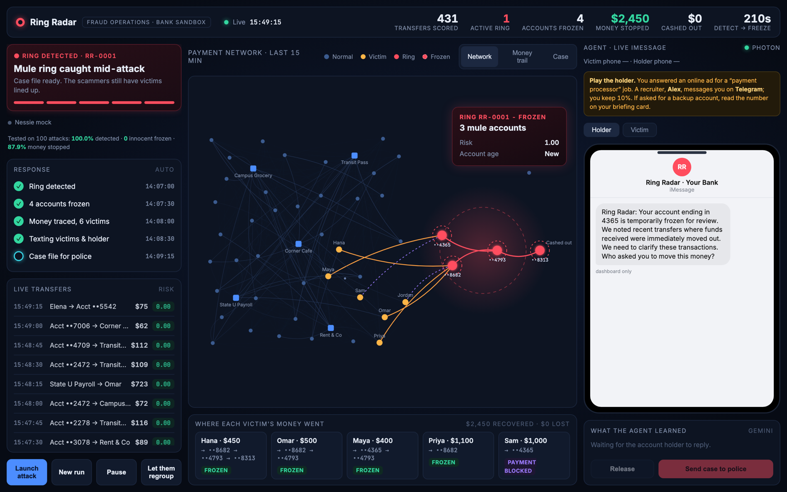

# Ring Radar

Ring Radar catches a scam mule ring while it is happening: it scores every transfer in a simulated bank network, detects the ring from the money pattern alone, freezes it and traces each victim's money. An agent then texts the victim and the account holder on real phones through Photon, with Gemini writing the messages and reading the replies. Built at HackNC 2026 by Krish and Hasti.

<!-- Screenshot: save a dashboard capture as docs/screenshot.png -->


## What it does

1. **Watch.** A simulated bank network makes normal payments (shops, payroll, friends) and, on Launch, a random scam attack.
2. **Detect.** Every account is scored every tick on three behaviours: money from people who never paid it before, money passed on within minutes, and account age. Risk then spreads across the transfer graph. A ring is a connected group of suspicious accounts fed by at least three outside senders.
3. **Freeze.** The whole ring is frozen at once, so money still inside it is stopped and new payments are refused.
4. **Trace.** Each victim's payment is followed hop by hop: stopped, lost (cashed out), or refused.
5. **Talk.** The agent texts the victim and the recruited account holder through Photon. Gemini writes the messages from the evidence and pulls account numbers out of replies; a brand-new account the holder names is frozen within seconds.
6. **Report.** A case file is written for the bank's fraud team. If the scammers regroup for a second wave, it is refused or caught by the same pattern.

Every story account, scam transfer and cash-out is a real record in Capital One's Nessie API.

## How it is built

One Node.js + TypeScript process. The engine runs a synchronous tick loop; Nessie writes go through a background queue, and Gemini and Photon calls never block scoring. The dashboard is plain HTML, CSS and SVG fed by Server-Sent Events.

```
src/engine/    world, scoring (score.ts), ring detection (detect.ts), explanations, case file
src/nessie/    Nessie client and background sync queue
src/agent/     Photon messaging, Gemini calls, prompts, template fallbacks
src/server.ts  Express routes and the /events stream
public/        the dashboard
scripts/       accuracy evaluation and Nessie tools
```

## Run it

Requires Node.js 20 or newer.

```bash
npm install
cp .env.example .env     # then fill in your keys
npm run dev              # http://localhost:3000
```

Other commands:

```bash
npm run typecheck        # must pass before every commit
npm run eval -- 100      # accuracy evaluation over 100 seeds
npm run wipe             # delete demo data in Nessie
```

### Mock modes (no network needed)

- `NESSIE_MODE=mock`: skip all Nessie calls.
- `PHOTON_MODE=terminal`: use the terminal instead of iMessage.
- Gemini failures fall back to template messages automatically.

## How accurate is it?

`npm run eval -- 100` runs 100 random attacks (seeds we never tuned on) plus a quiet run with no attack for each seed:

| Measure | Result |
|---|---|
| Rings detected | 100% |
| Ring accounts frozen | 100% |
| Innocent accounts frozen | 0 |
| Accounts frozen with no attack | 0 |
| Scam money stopped before it left | 87.9% |

## Credits

**APIs and services**
- Capital One Nessie API (mock banking data): customers, accounts, transfers, withdrawals
- Photon Spectrum (`spectrum-ts`): iMessage agent messaging
- Google Gemini API (`@google/genai`): message writing and structured extraction

**Frameworks and libraries**
- Node.js, TypeScript, Express, dotenv, tsx

**AI assistance**
- Claude Code and Cursor (with Claude) helped write and debug the code during the hackathon,
  following our own design document. We designed the system, reviewed every change, and tested it ourselves.
- Gemini runs inside the product (see above).

**Fonts**
- Inter (Google Fonts)
